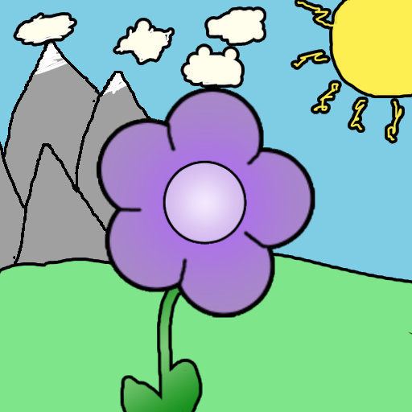

  
<h1 align="center">Violet</h1>

> ### __An addon for the [Project: Lotus](https://lotusau.top/) Among Us Mod.__ 
> This addon/mod is not affiliated with Among Us or Innersloth LLC, and the content contained therein is not endorsed or otherwise sponsored by Innersloth LLC.
 Portions of the materials contained herein are the property of Innersloth LLC.  

### [Download Violet](https://github.com/ThetaHalo/Violet/releases/latest) - [Download Project: Lotus](https://get.lotusau.top/)  
--- 

### 🪷 - This requires Project: Lotus in order to work. You can install it from the link above.

## Features/Additions:
| Features                                                                                                |
|:--------------------------------------------------------------------------------------------------------|
| Included Crowded Support, meaning you can play with 15+ players on Modded Regions.                      |
| Adds support for **ehT dlekS**, so you can play it in Project: Lotus.                                   | 
| "Functional" support for The Fungle (You can play the CTF & ETF Gamemodes, as well as use Random Spawn) | 
| "Functional" support for Submerged (Random Spawn support & CTF Support)                                 | 
| 9 new modifiers, 8 new roles, and more on the way!                                                      | 
| Command Suggestions: Autocomplete commands by pressing tab while typing one.                            | 
| Various cut/removed features (re)implemented                                                            |
| Various UI Improvements.                                                                                | 
| Shows notification messages in meeting displaying the time left.                                        | 
| Show the result of the previous meeting above the Meeting Table.                                        |
| Private chats for Impostors, Romantics & Jailor/Jailed People.                                          |
| Support for changing the scale of the GUI.                                                              |
| Support for zooming the camera out when dead or when in lobby.                                          |
| A simple in-game anticheat for blocking malicious hackers in lobby.                                     | 
| Option to automatically recreate your lobby upon disconnecting, mainly for auto-hosters.                |
| Various new commands for moderation, fun, and miscellaenous things.                                     |
| Various custom buttons for roles (which replace the vanilla buttons).                                   |
| **Even more for you to discover! (i forgot the rest)**

---

## Commands

:::note
> Some commands are required to use the /cmd prefix, while others can use either / or /cmd.
:::

|  Prefix  | Command Name  |      Flags       | Description                                                                                               |
|:--------:|:--------------|:----------------:|-----------------------------------------------------------------------------------------------------------| 
|   /cmd   | archangelchat |  In-Game, Host   | Talk to your Archangel partner as an Archangel                                                            |
| / & /cmd | endmeeting    | In-Meeting, Host | Ends the currently active meeting.                                                                        |
|   /cmd   | impostorchat  |   In-Game Only   | Send a message to your impostor partners.                                                                 |
|   /cmd   | jailorchat    |   In-Game Only   | If Jailor or Jailed, talk to the Jailed/Jailor.                                                           |
|   /cmd   | romanticschat |   In-Game Only   | Talk to your romantic partner as a Romantic (or romanced player)                                          |
| / & /cmd | kill          |  Moderator Only  | Kill/Execute a player                                                                                     |
| / & /cmd | rtp           |   In-Game Only   | Teleport to a random room on the map (when dead.)                                                         |
| / & /cmd | roulette      |   In-Game Only   | Play a game of Russian Roulette, if you lose then you will be kicked. (Host can disable this in settings  | 
|   /cmd   | vote          |   In-Game Only   | Vote a player in the current meeting (meant for when using Crowded.)                                      |
|   /cmd   | will          |  In-Game Only    | Write a will, which will be displayed in meeting upon your death. (Host can disable this in settings)     |

---

## Roles:
Click [here](https://gist.github.com/ThetaHalo/a20611cffbe456ae48ba83882c1b1cc4) to view all of the roles in Violet! \
(website coming soon)

---

## Credits:
**Individuals**
> [ThetaHalo](https://github.com/ThetaHalo) - Developer of Violet.  
> [Discussions](https://github.com/discus-sions) - Lead Dev of Project: Lotus, also provided code for Drunk Modifier, (certain) Freeplay Patches & various pieces of code around the addon.  
> Piggy B - Various art assets (which were included in Lotus but were reused in Violet)  
> **[Members of Lotus' Testing Team](https://lotusau.top/credits)** - For helping me test Violet and providing feedback/suggestions  

**Mods**
> [Lotus-AU/LotusContinued](https://github.com/Lotus-AU/LotusContinued): Various code snippets & code references, also the only reason this addon exists.  
> [ThetaHalo/LotusDiscordRPC 🕊️](https://github.com/thetahalo/lotusdiscordrpc): Code for the Discord Presence. 
> [ThetaHalo/BetterAutoHostAddon 🕊️](https://github.com/ThetaHalo/BetterAutoHostAddon): Code for auto-remaking lobbies.  
> [CitrionDragon/CrowdedAddon](https://github.com/citriondragon/crowdedaddon): Code for the Crowded Patch (though modified). 
> [Gurge44/EndlessHostRoles](https://github.com/Gurge44/EndlessHostRoles): Idea for Car Role & Code Reference 
> [Tommy-XL/Unlock-dlekS-ehT](https://github.com/Tommy-XL/Unlock-dlekS-ehT): Code for DleksPatch (though modified) 
> [SubmergedAmongUs/Submerged](https://github.com/SubmergedAmongUs/Submerged): Certain code references for adding Submerged Support  
> [AU-Avengers/TOU-Mira](https://github.com/AU-Avengers/TOU-Mira) & All-Of-Us-Mods/MiraAPI: Code reference for features like GUI Scale, Role Tab, and TMP Sprite Assets + Code References for some Harmony Patches 
> [D1GQ/BetterAmongUs](https://github.com/D1GQ/BetterAmongUs): Code reference for Command Suggestions & Certain Meeting UI Changes.  
> [TownOfNext/TownOfNext](https://github.com/TownOfNext/TownOfNext): Code for ZoomPatch.  
> [NuclearPowered/Reactor](https://github.com/NuclearPowered/Reactor): Code for skipping intro cutscene when opening game. 
